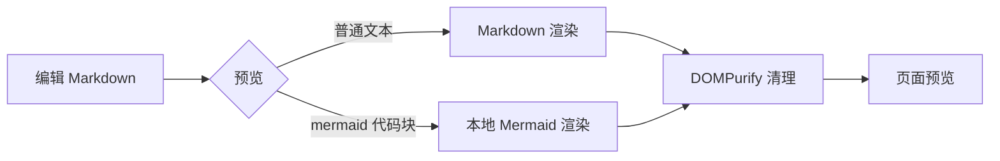
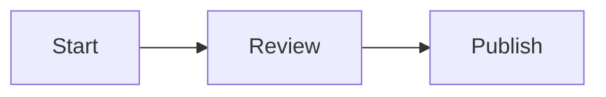

# 私有文档与流程图

站主可在后台的「私有文档」页面记录不公开的 Markdown 文档，并用 Mermaid 代码块预览流程图。文档与公开文章分表存储，不会出现在博客、RSS、站点地图或读者账号中。



## 使用方式

- 后台地址：`/admin/documents`
- 新建文档后填写标题、可选分类和正文，点击保存。
- 使用 Mermaid 代码围栏书写流程图，例如：

````text

````

- 编辑和预览切换不会修改文档正文；删除操作会要求二次确认。
- 文档仅站主可读写，读者账号和未登录访问会被 API 权限层拒绝。
- 页面通过版本号检测并发修改。出现 409 时先刷新文档，再将需要的修改手动合并。
- 搜索会在当前已加载的文档标题、分类与正文中匹配；当前文档量适合个人知识库使用。

## API

以下接口使用站主的同源会话 Cookie，不接受 AI Access Token：

| 方法 | 路径 | 作用 |
|---|---|---|
| `GET` | `/api/private/documents` | 列出站主的文档 |
| `POST` | `/api/private/documents` | 创建文档，正文最多 200,000 字符 |
| `PUT` | `/api/private/documents/{id}` | 更新文档，必须提供当前 `version` |
| `DELETE` | `/api/private/documents/{id}` | 删除文档，必须提供当前 `version` |

所有写入使用同源 Origin 检查并写入审计记录。Markdown 原始 HTML 不启用；预览输出经过 DOMPurify 清理。Mermaid 以严格安全模式在浏览器本地运行，不调用外部 CDN 或服务器端网络。

## 备份与升级

数据库版本由 V9 升至 V10 时会自动创建 `data/migration-safety/before-v10.sqlite`。全站 CLI/Docker 备份直接包含该表。站内 JSON 备份新增可选 `documents` 数组；恢复旧版备份时，如果该字段不存在，现有文档会保留。恢复含 `documents` 字段的备份时，文档书架会替换为备份中的内容。

从 V9 部署升级时，应用启动会自动执行 SQLite 表迁移。部署前仍应按 [部署手册](DEPLOY.md) 先备份 `data/`，确认新版本健康后再切换流量。
