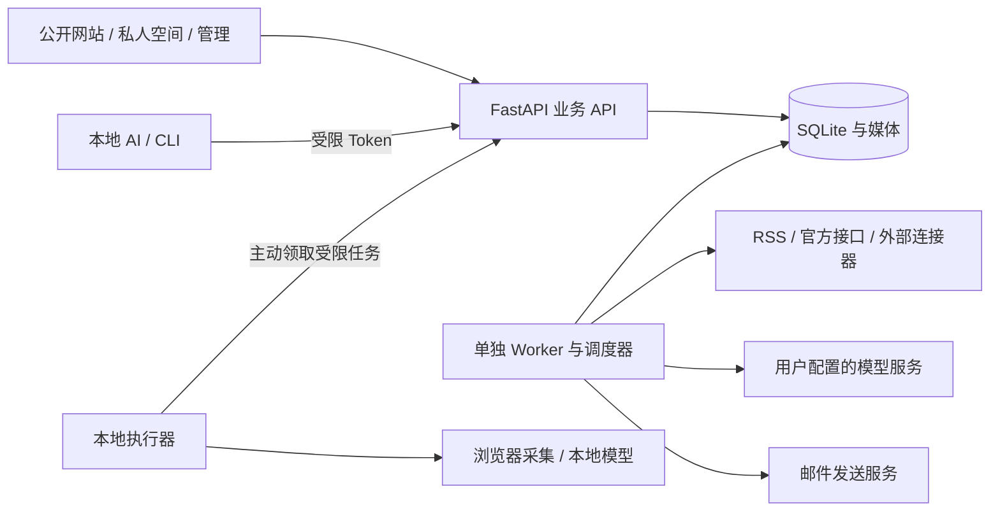
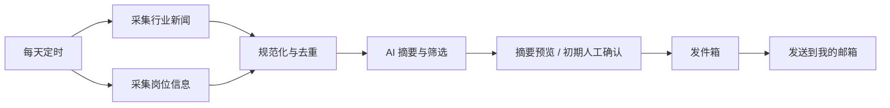

# 个人网站平台化升级：可行性分析与分阶段建议

本文保留前期方案讨论，涉及“待实施”和估算的内容不是最终交付状态。V10 当前需求对照、实际能力和验收边界以 [升级版交接](V10-handoff.md)、[功能说明](FEATURES.md) 和 [安全验证记录](SECURITY.md) 为准；本站名已调整为可配置的“拾帧之间”。

更新日期：2026-11-06。分析对象：当前本地 V10 源码，以及现有 2 核 4G、宝塔、Docker 部署环境。

本文区分现有实现、建议方案和待实施事项。当前工作区已有 Access Token/文章草稿与发布 API/JSON 草稿导入、邮件周报基础和封面预览修复；本地验证为 22 项 Python 后端测试、17 项 Node 回归、完整浏览器回归、封面专项浏览器回归及前端构建均通过。SMTP 仅使用 mock，未连接真实邮箱；安全回归不是第三方渗透测试。本次邮件错误诊断与连接方式提示已加入本地工作区，仍需用真实邮箱测试收件箱验证。以上变更尚未推送或部署，线上服务器仍运行独立部署版本，需按升级手册另行演练。

## 1. 结论

可行。适合把现有项目逐步发展成“个人内容网站 + 私人知识与生活空间 + 轻量自动化”，继续使用 Vue 3 和 FastAPI，不必为了增加功能再次整体换技术。定位是个人开发者维护的个人产品，不面向客户现场配置，不建设企业级低代码平台；底层以接口、配置模型和清晰契约支持持续发布新版本。

保留值得借鉴的工程能力：统一数据模型、清晰权限、状态流转、接口契约、版本管理、操作审计和失败恢复。可编辑性主要指站点主页模块、主题、内容呈现和个人空间布局能由站主调整；功能、权限模型和复杂交互通过开发与发布版本更新。管理功能放在个人空间内，只有出现明确的信息架构或安全隔离需求时才分出独立设置中台。

建议按以下顺序推进：

1. **稳定接口和版本升级路径**：为内容、媒体、个人设置、邮件和自动化定义契约，功能改进以代码版本发布为主。
2. **个人空间与内容能力**：增加必要的文档、收藏、邮件报告和少量页面自定义，不建设通用页面搭建器。
3. **可靠的轻量自动化**：邮件周报配置、预览、手动发送、自动计划与投递历史已实现基础版；下一步再实现定时采集、去重、预览、保存到个人空间，并确认真实来源可用后再扩展插件形态。
4. **Claude 视觉实现**：先固定路由、数据模型、API 和交互状态，保留可替换组件接口；功能页由当前开发流程完成，品牌首页与视觉体系交给 Claude 迭代。

视觉交接从早期开始，但不阻塞功能开发。先确定页面职责、稳定的 props/events、路由和数据加载边界；Claude 可替换布局、样式与动画，不需要接管业务规则或服务端。完整视觉替换晚于接口定稿。

## 2. 当前代码提供了什么

以下是本地源码事实，不是本轮对线上环境的检查结论。

| 能力 | 当前状态 | 平台化所需变化 |
| --- | --- | --- |
| 博客与空间 | Vue 3 博客、管理外壳、两种空间主题、生活工具 | 统一模块契约、导航与加载策略；设置逐步并入个人空间 |
| 后端 | FastAPI，接口集中在 `backend/api.py`，安全边界在 `main.py` | 按业务拆模块，抽离认证、业务服务、外部适配器 |
| 账号与权限 | 站主管理员；读者注册需审核；读者无创作权限 | 保持人类角色简单，增加独立的机器授权范围 |
| 自动化令牌 | 现有 `space_…` 用于生活记录接入；新增 `sk-…` Access Token 按 scope 授权、哈希存储、限频、过期、可撤销、明文仅创建时显示 | 新令牌和旧生活记录令牌保持不同权限与用途；SK Token 只是命名/展示习惯，不是另一类凭证 |
| JSON 接入 | `POST /api/v1/imports/validate` 可校验最多 50 篇文章，`POST /api/v1/imports` 仅能创建草稿；单次事务提交，检查文章链接与媒体所有权 | 目前没有通用备份恢复、分批导入、文章更新或批次撤销；先完善导入契约、文档和安全测试 |
| 文章创作 | 管理员 Cookie 登录，已有版本冲突保护 | 提供 Token API、内容修订历史、独立发布权限 |
| API 文档 | 开发模式可查看 OpenAPI，生产文档关闭；新增 Token API 当前仍以 `dict` 接收请求 | 补静态契约、样例和输入输出模型；不可把开发 Swagger 暴露到公网 |
| 富文本 | Markdown、代码高亮、图片；原始 HTML 关闭 | 文档集合、附件、Mermaid 与受控文档块 |
| 数据 | SQLite WAL，部分业务以 JSON 存记录 | 显式迁移脚本，新增工作流/修订/密钥引用等表 |
| 工作流 | 未有持久工作流执行引擎 | 新建任务队列、状态机、执行器协议与运行记录 |
| 外部调用 | Git 动态已有后台缓存、超时、退避 | 抽出复用的连接器规范；不要直接扩成任意 HTTP 代理 |
| 工具前端 | 同源 iframe 隔离 CSS，Vue 渲染器复用旧模板 | 高频模块逐步组件化，避免新功能继续堆进旧模板 |

### 2.1 文章封面上传预览问题

已知现象是：文章编辑时移除默认封面并选自己的图片后，编辑器预览加载失败，文章发布后同一图片又能正常显示。当前实现中上传接口先把图片写入 `/uploads/{name}` 并返回 URL，保存文章时再持久化该 URL；管理端封面预览与公开文章展示是两条独立的图片请求链路。因此“发布后可见”说明上传和持久化大概率成功，故障更可能位于上传后立即加载预览时的 URL 解析、浏览器缓存/请求时序或临时返回对象格式，而不是服务器最终存储本身。仅凭现象不能断定是网络；实施时要在浏览器 Network 面板比较预览请求与发布页请求的 URL、状态码、响应头、重定向和响应体，并检查相对路径在管理路由下的解析。

本地改动已允许 CSP 的 `img-src` 使用 `blob:`，因为 Element Plus 选择本地文件后通过 blob URL 预览；组件加入加载、失败、重试和重新选择状态，文章保存流程在 finally 中关闭上传遮罩。专项 Playwright 回归脚本覆盖本地预览、失败重试、上传成草稿及未发布图片权限，已在本地通过。修复尚未部署到线上。

现有令牌不是通用 AI 管理密钥，旧的 JSON 备份恢复也不是安全的内容批量导入工具。不能只换一个 `sk-` 前缀就认为这些能力已经具备。

## 3. 产品边界与导航

网站面向访客，个人空间面向自己，功能和设置优先放在个人空间内。当前站长是唯一主要配置者，没有必要把日常设置再拆成一个“中台”；只有未来出现多站点、协作者、复杂审计或独立权限边界时再拆独立管理入口。继续避免“工作台、Studio、后台”三个入口重复同一套功能。

| 区域 | 主要页面 | 可见范围 |
| --- | --- | --- |
| 公开网站 | 主页、文章、说说、相册、项目/作品、精选文档、关于 | 游客和读者；仅已发布且公开的内容 |
| 个人空间 | 个人首页、草稿、知识库、收藏、生活记录、自动化结果、邮件计划、页面外观与站点设置 | 站主 |
| 功能设置 | 内容管理、媒体、评论审核、工作流定义、Access Token、连接器 | 作为个人空间中的设置分区/页面，不另造一个中台产品 |
| 读者账户 | 头像简介、个人账户、允许的互动 | 对应读者；不增加创作与自动化权限 |

站主可从公开网站进入“我的空间”，空间内直接写文章、管理文档或运行流程。管理操作复用编辑器与表单，不再为同一篇文章建设第二套创作页面。

公开主页可配置的模块可包括：个人简介、置顶作品、最近文章、说说、相册精选、技能/经历、公开文档入口、Git 动态、ACG 收藏精选。私人生活记录和工作流采集结果默认不进公开主页。ACG 个性化应保留在主题和可选模块中，不能依赖整站公开私人信息来营造氛围。

## 4. 可编辑性、个性化与首页开场

个人使用中的“可编辑”指页面内容与呈现可调整，而不是站主通过低代码平台开发新功能。建议提供有限、可恢复的站点定制项：

- 首页模块显示/隐藏、排序、精选内容和少量布局选项。
- 品牌名、头像/Logo、封面、主题预设、强调色和动效偏好。
- 个人空间的模块排序、收藏分组和工作流输出目标。
- 文档中的 Markdown、图片、代码、引用、表格和受控外站嵌入。

功能页和复杂交互由版本升级交付；页面配置使用有版本的 Schema、默认值、校验、预览和恢复。数据库存结构化配置，不存任意 Vue 模板、JavaScript、Python、系统命令或任意 CSS。无需为客户现场“照顾式配置”建设拖拽画布、组件市场、角色化搭建或通用低代码引擎。

站名采用“拾帧之间”，域名、仓库名和应用版本保持不变。首页开场以站点配置中的“拾帧之间”为唯一文字来源：多张照片/文章封面裁切成图块并拼出站名，短暂停留后通过镜头推进、遮罩或景深转场进入现有轮播首页。开场应可跳过，优先只在首次访问播放并允许访客设置重播；不应阻挡直接访问文章深链。图片需要缩略尺寸、延迟加载和数量上限，首屏准备失败、脚本关闭或用户启用减少动效时直接显示轮播首页；动画结束后释放不用的媒体资源，不在背景持续运行重型 Canvas/WebGL。

Claude 的交接边界是稳定路由、API 类型、状态和组件接口（props/events/slots）；可调整布局、样式、动效和响应式细节，不改业务规则、数据模型、权限或请求契约。详细组件范围、提示词和验收标准见 [Claude 前端设计交接说明](Claude前端设计交接.md)。

## 5. 建议架构与资源安排

采用“模块化单体 + 独立 Worker + 可选本地执行器”。这里的模块化是代码和契约边界，不意味着拆成很多微服务。



API 只接收和验证请求、保存任务并快速返回，耗时步骤交给 Worker。不能用一次 HTTP 请求或进程内临时后台任务承载需要跨重启继续的流程。

建议的后端职责：`content`、`documents`、`media`、`site`、`identity`、`automation`、`workflows`、`connectors`、`audit`。路由只处理协议，业务服务统一执行权限、状态转换和事务，Cookie 与 Token 入口复用同一业务规则。

### 5.1 2 核 4G 预算

以下是初始配置预算，需要真实负载测量，并非已有压测结论。

| 服务 | 建议初始限制 | 说明 |
| --- | --- | --- |
| Web/API | 约 768MiB | 延续单进程，小请求快返回 |
| 工作流 Worker | 约 512–768MiB，并发 1 | I/O、摘要调用和轻解析，避免大文件驻留 |
| 宝塔/Nginx/系统 | 预留约 1–1.5GiB | 按实际系统占用调整 |
| 剩余空间 | 用作系统余量和峰值 | 不安排本地大模型或常驻浏览器集群 |

默认轻量工作流合计在宿主机 2 核预算内运行；不把 Web 和 Worker 的 CPU 配额都配置成可长期满占 2 核。浏览器采集、复杂 OCR、Office 转换放到本地/外部执行器。构建镜像继续优先在本机进行。

### 5.2 数据库与升级

第一阶段继续 SQLite；一个 Worker 用短事务领取任务、保存租约和心跳，不在外部请求期间持有写锁。SQLite WAL 可以支持个人规模的 Web 与 Worker，但写入仍串行，不能按 PostgreSQL 的并发假设设计。

为令牌 scopes、内容修订、页面配置、文档集合、导入批次、工作流定义/版本、执行记录、步骤结果、任务租约、凭据引用、发件箱建立清晰模型。调度定义、执行租约、幂等结果应放在专用表，不全部塞进通用 `records` JSON。

先引入顺序编号的可审查迁移与恢复演练，再考虑引入 ORM。备份、升级和版本检测沿用现有数据目录策略，保留文章 URL、原文件名和既有账号。

出现持续写锁等待、多个 Worker、跨主机部署或任务量明显增长时，再迁移 PostgreSQL。首期不默认安装 Redis、Celery、Kafka 或容器编排集群；它们能解决更大规模问题，也增加部署与恢复负担。

### 5.3 本地与云端的任务边界

采用“云端协调和保存、本地按需执行重任务”的混合模式，不要求把所有工作流都搬到本地：

| 云端（2 核 4G） | 本地执行器或外部服务 |
| --- | --- |
| API、身份权限、配置、定时计划、轻量 Worker、SQLite、任务状态与审计 | 需要真实浏览器/登录态的采集、OCR/Office 转换、本地模型推理、大批量图片处理 |
| RSS/官方 API、小页面提取、去重、短文本规则处理、邮件发件箱和个人空间保存 | 本地私有文件处理、不上传的数据清洗、超出服务器资源预算的渲染与转码 |
| 领取/回传受限任务、重试与结果通知 | 只领取明确类型和参数的任务，回传经过 Schema 与大小校验的结果 |

用 RSS/官方接口、规则归一、限量缩略图和单并发 Worker；图像压缩/裁切优先在浏览器或本地构建机处理后上传。云端不跑常驻 Chromium、本地大模型，也不接任意 Shell 命令。个人设备关机或离线时，任务应标为 `waiting_executor`、过期或按策略跳过；定时邮件不应无限积压后补发。能由云端廉价可靠完成的步骤留在云端，涉及本机环境或明显高 CPU/内存的步骤才下放。

## 6. AI 接入：版本化 API 与 sk Token

### 6.1 授权模型

SK Token 就是网站 Access Token 的一种命名/展示形式，不另设一种授权机制。可以采用 `sk-…` 或 `sk-lin-…` 前缀；前缀只用于识别和操作体验，不表示兼容某家模型 API。它是访问你网站的凭证，与模型服务商的 API Key 完全独立。接口名称、存储、认证和撤销均按 Access Token 设计，必要时保留旧 `space_…` 兼容。

密钥建议由可识别的公开 key ID 和至少 256 bit 随机秘密组成；服务端只保存秘密摘要、可展示前缀、所属主体、scopes、到期日、最近使用时间和撤销状态。明文只在创建时显示一次。每个 AI 工具单独发密钥，避免共用一个全权钥匙。

| scope 示例 | 用途 | 默认建议 |
| --- | --- | --- |
| `content:read` | 读取获准的内容 | 限内容类型/可见范围，不自动包含全部私人记录 |
| `content:draft:write` | 创建与更新 AI 草稿 | 本地写作助手的默认权限 |
| `content:publish` | 发布明确允许的内容类型 | 站主按需单独授予，可限制分类和公开范围 |
| `media:write` | 上传受限附件 | 独立文件大小、数量和总额度 |
| `imports:write` | 导入、校验和提交批次 | 不能因此绕过发布权限 |
| `workflows:run` | 运行指定已发布流程 | 不等于可以编辑流程或查看其秘密 |
| `tasks:claim` / `tasks:complete` | 执行器领取、回传任务 | 限执行器能力和任务类型 |

默认不给创建新令牌、编辑连接器凭据、用户管理、审核评论或清空数据等权限。旧 `space_` 令牌保持原能力与有效期，不自动升级为内容发布密钥。

管理员 Cookie API 继续做 Origin/CSRF 检查；新 `/api/v1/automation/…` 独立使用 Bearer 认证，不依赖浏览器 Cookie，也不因附带 Cookie 自动提权。不能为了兼容本地 AI 全局关闭来源校验。

### 6.2 当前 API 与后续契约

以下新接口已写入当前本地源码，仍需随本地回归一起验收；尚未推送或部署。它们与早期方案路径不同，以代码路径为准：

| 方法与路径 | 当前行为 |
| --- | --- |
| `POST /api/v1/posts` | `Bearer` Access Token 创建文章草稿；Token 同时具备 `content:publish` 且请求明确要求时才可发布；必须提供 `Idempotency-Key` |
| `POST /api/v1/imports/validate` | 校验最多 50 篇文章，不写入内容 |
| `POST /api/v1/imports` | 最多 50 篇文章事务式导入为草稿，拒绝重复 slug、越权发布和无权媒体 |
| `/api/private/access-tokens` | 站主 Cookie 管理 Token；创建时返回一次明文，可设 scope/有效期并撤销 |

当前尚无文章更新/修订 API、AI 媒体上传 API、导入批次状态/撤销、MCP 接口和生产 OpenAPI 静态文件。下一步以 OpenAPI/JSON Schema 和接口示例为准补齐契约，不能在设计文档里把提案路径当成已上线 API。

后续可考虑的接口方向（不是当前可调用地址）：

| 方法与路径 | 职责 |
| --- | --- |
| `POST /api/v1/automation/posts` | 创建草稿；显式请求发布时再检查发布权限 |
| `PATCH /api/v1/automation/posts/{id}` | 更新草稿，必须携带版本前提 |
| `POST /api/v1/automation/posts/{id}/publish` | 显式发布，产生发布记录 |
| `POST /api/v1/automation/moments` | 以独立模型创建说说，不混进文章类型 |
| `POST /api/v1/automation/media` | 上传并返回媒体引用，不按 URL 任意抓取图片 |
| `POST /api/v1/automation/imports/validate` | 无业务写入地检查 JSON，返回预览与错误 |
| `POST /api/v1/automation/imports` | 创建可追踪导入批次，默认生成草稿 |
| `GET /api/v1/automation/jobs/{id}` | 查询导入或流程的执行结果 |
| `POST /api/v1/automation/workflows/{id}/runs` | 运行获准且已发布版本的流程 |

明确区分小型同步操作和异步任务；异步成功受理返回 202 与 job ID，并不表示工作已经完成。读接口分页与筛选，避免公开文章全文列表随数量无限增大。

文章输入示例（字段仍需以当前 `validate_record` 约束为准）：

```json
{
  "schemaVersion": "1.0",
  "externalId": "local-ai:erp-notes-001",
  "title": "ERP 学习笔记",
  "slug": "erp-learning-notes-001",
  "format": "markdown",
  "content": "# 今天学到了什么\n\n正文……",
  "category": "学习笔记",
  "tags": ["ERP", "软件设计"],
  "visibility": "private",
  "requestedState": "draft"
}
```

请求头使用 `Authorization: Bearer <网站密钥>`、`Idempotency-Key`。目前创建 API 已实现幂等键和同键不同载荷 409；更新版本控制、待发布修订和媒体上传仍待实现。未来更新只选一种并发前置条件（如 `If-Match`），已发布文章修改默认创建待审/待发布修订，不能让 AI 保存草稿时直接改动线上正文。

服务端限制未知字段、标题/正文大小、slug、标签、状态流转、媒体所有权和批次数量。AI 提交的作者 ID、权限、可信 HTML、流程代码不作为可信输入。统一错误应含机器可读 `code`、`message`、字段错误、`requestId` 和是否适合重试；保留旧 API 的响应结构作为兼容层。

### 6.3 JSON 导入

导入应有版本化格式、逐条预览、字段定位、重复检查、目标类型、预计新建/更新数量、权限和可见性提示。内容、页面配置、工作流定义、站点全量恢复各自使用不同格式，不设一个可以导入所有内部表的万能 JSON 入口。

小批次先完整校验再事务提交；大批次分批执行，明确部分成功、失败项与重试行为，不宣传全量原子性。必须定义空值与缺失字段、覆盖模式、externalId 冲突、标签创建策略和时区。

JSON 只能引用已授权媒体或配套上传包，不允许任意本地文件路径。若后续支持 ZIP 包，需另外处理路径穿越、解压体积和文件数量限制。导入结果能追溯批次，但撤销只在版本未被后续编辑时安全执行，不能直接删除整批后续已修改内容。

### 6.4 给本地 AI 的最短接入路线

第一阶段提供 OpenAPI 静态文件、JSON Schema、curl/Python 样例和少量清晰工具说明。开发环境的 Swagger 不自动等于稳定契约：当前多个接口接收宽泛 `dict`，新增 API 要显式声明输入、输出和错误模型。

优先直接 HTTP 调用。以后有需要再做薄 MCP 适配器，复用同一业务 API 与 scopes，不让每一种 AI 工具各自操作数据库，也不先建设一个新的智能体框架。

## 7. 文档内嵌与流程图

### 7.1 文档中心（规划）

建议先采用 Markdown + 目录集合：文档集合、层级目录、草稿/发布修订、搜索、标签、访问级别、永久链接。项目页可以引用特定文档或图表块，附件权限独立校验。

私有文档不能因嵌入公开文章自动公开。发布预览应报告私有依赖；需要站主明确发布对应文档/附件，或发布指定的公开快照。公开路由、搜索索引、RSS、站点地图、预览图和缓存都要遵守相同可见性规则。

### 7.2 嵌入能力分级

| 类型 | 首期处理 |
| --- | --- |
| 站内 Markdown 文档 | 原生渲染与引用，最优先 |
| Mermaid 文本流程图 | 懒加载渲染，严格模式，禁用点击动作与不受控 HTML |
| PDF | 同源受控附件，按需用 PDF.js；下载与预览均校验权限 |
| DOCX/XLSX/PPTX | 首期附件下载或离线转换为 PDF；不自建在线 Office |
| 外部网页 | 单独评估允许域和 iframe 策略；对方可能禁止嵌入 |
| 任意 HTML/脚本 | 不支持作为普通内容输入 |

### 7.3 外站开发文档嵌入

外站文档适合做快捷阅读入口，但 iframe 是否成功取决于目标站的 `X-Frame-Options` / CSP `frame-ancestors`，不能假设任意站点都允许内嵌。优先保留普通新标签页作为可靠回退，并只对确认允许嵌入、稳定、HTTPS 的域名开白名单。开发文档可先评估 Vue 官方文档（`https://vuejs.org/guide/`）、FastAPI 文档（`https://fastapi.tiangolo.com/`）、MDN Web Docs（`https://developer.mozilla.org/`）、TypeScript 文档（`https://www.typescriptlang.org/docs/`）及 Vite 文档（`https://vite.dev/guide/`）；上线前从香港服务器和目标浏览器实际验证连通性、中文内容、移动端和嵌入响应头，未允许 iframe 的站点只提供站内目录/书签与新标签打开。不要做代理抓取整站文档，避免版权、缓存和维护成本。

如果用于个人开发参考，建议做一个“文档书架”收藏页，提供站内搜索/标签、来源说明、最近访问和外链打开；能 iframe 的作为渐进增强，不能嵌入时仍可正常使用。源站 API、CSP 和网络情况可能变化，具体可嵌入清单需实施时在线复核。

Mermaid 渲染与富文本要限制长度、复杂度和渲染时间，清理生成结果，验证严格 CSP 下的实际行为；必要时用隔离 iframe。PDF 查看器、流程编辑器拆分包并懒加载，避免公开首页为管理功能下载大依赖。

Markdown 写作目前可继续复用现有编辑器。只有在明确需要所见即所得的块编辑、复杂粘贴和多人协同时，再评估 Tiptap/ProseMirror 等；它们是新增能力和迁移成本，不是必然比 Markdown 更适合。

**展示流程图与可执行工作流是两种模型。** Mermaid 文本用于文档表达，工作流运行使用可校验的节点与边 JSON；可以互相导出展示，不能执行 AI 生成的任意图表代码。

## 8. 插件式工作流的可行设计

### 8.1 范围与状态

首版不要求用户编辑通用 DAG。先用代码定义的少量流程模板和表单参数（例如 RSS 周报、新番收藏），支持手动/定时触发、预览/确认、保存和邮件。运行内核可以按 DAG 节点模型组织，只有当固定流程种类和维护成本证明需要时，再开放受限节点编辑器。暂不支持任意循环、任意脚本、动态加载网页插件或完整 BPMN。

基本状态建议：`draft → published → enabled/disabled` 属于定义；运行状态为 `queued / running / waiting_approval / waiting_executor / succeeded / failed / canceled / expired`。每个运行固定一份已发布定义快照、节点版本和输入，编辑流程不能影响已经开始的运行。

Worker 原子领取任务并设置租约，定期续租；崩溃后过期任务可以重新领取。调度器通过唯一键避免同一计划时刻重复生成运行。任务有超时、最大重试、取消检查点、并发上限、退避和数据保留期。长审批必须持久保存，不能靠占住 Worker 等待。



### 8.2 首批节点

| 节点 | 输入 / 输出 | 关键限制 |
| --- | --- | --- |
| 定时触发 | 时区、频率 / 计划时刻 | 最短间隔、错过计划的补跑策略、避免补跑风暴 |
| RSS/官方 API | 配置的源 / 标准条目 | 首选，缓存、条件请求、每源限速 |
| 页面提取 | 允许的 URL / 正文与来源元数据 | 有请求和解析上限，必要时交执行器 |
| 岗位适配器 | 平台、关键词、地区 / 岗位列表 | 按平台分别适配；未知字段可空，不伪造 |
| 去重筛选 | 条目 / 新条目与过滤原因 | 来源 ID、规范化链接、内容哈希、时间窗口 |
| AI 摘要 | 有来源的文本 / 类型化摘要 | 固定输出 Schema、长度和调用额度，保留引用 |
| 人工确认 | 待处理产物 / 同意、拒绝或过期 | 持久等待，不占执行线程 |
| 保存文档/草稿 | 规范内容 / 内容引用 | 私有草稿为默认，可关联源条目 |
| 邮件发送 | 模板和连接器引用 / 投递结果 | 收件人允许清单、频率与去重；不把秘密交给 AI |

新闻与岗位应作为两条独立输入分支，汇总时定义“一个源失败仍发部分摘要”或“全部失败就停止”的策略，不能因部分异常生成看起来完整的报告。

### 8.3 邮件推送：手动与定时周报

邮件是自动化的首个交付渠道。配置一个专用、低频使用但可稳定授权 SMTP/API 发信的邮箱作为发件账户，报告默认只发给站主验证过的收件地址；发件邮箱不应被当成安全边界或用来接收未审查的任意任务。凭据只在设置页写入/替换，服务端加密或由部署 Secret 注入，页面不可再次读取明文。

当前本地代码已具备 SMTP 配置加密保存、连接/测试发送、最近 7 天已发布文章预览、立即发送、定时周报、投递记录及明确失败重试；未知投递结果不能自动重试。定时逻辑目前运行在 API 单进程的应用生命周期中，每 30 秒轮询；只适合当前单实例、单进程使用。报告数据范围目前仅含公开发布的文章，不含私人日志、自动化结果或用户自选数据源。配置、加密密钥和真实 SMTP 都需上线前验证。未来增强应包括计划暂停入口、更清晰的投递错误/额度和调度健康状态；若改成多 worker/多副本，先拆出单例调度器或使用数据库锁，避免重复发信。

调度以站点时区和唯一计划时刻生成运行；报告与投递记录分开保存。失败按有限次数退避；供应商结果不明确时进入 `delivery_unknown` 并停止自动重发，避免重复邮件。管理页提供暂停全部自动邮件、暂停单项计划、立即重试明确失败任务和查看最近运行。使用 SMTP/API 仍需检查服务商应用密码/授权、TLS、每日额度、退信策略和垃圾邮件规范；先用测试收件箱验收再启用正式收件人。

### 8.4 简单任务流示例：季度新番收集（尚未实现）

“本季度新番”是适合验证任务流的低风险场景，建议按最小闭环实施：手动触发或季度初定时触发 → 从允许的 Yuciwiki 页面读取列表 → 解析标题、季度、播放信息和封面链接 → 规范化链接并按作品/来源 ID 去重 → 获取封面并校验格式与大小 → 保存为个人空间中的私有收藏/草稿 → 生成清单预览 → 可选邮件推送。先将来源和抓取频率固定，不要一开始建设通用插件市场。

实施前必须验证 Yuciwiki 的页面结构、robots/服务条款、反爬限制、图片来源与 hotlink 规则；没有稳定 API/RSS 时，页面解析器要有 fixture 回归和结构变更告警，来源不可用则明确报告失败，不伪造完整结果。封面只通过受限的站点连接器抓取，校验 MIME、体积、数量和最终 URL；临时外链可保留来源链接，长期收藏应保存合规的本地副本或可靠缩略图并注明来源。第一版先人工触发和预览，连续成功后再开季度定时及邮件推送。

其他适合个人站的自动化例子包括：RSS/博客更新周报、Git 提交与发布摘要、收藏网页转私人阅读清单、公开活动/报名截止提醒、个人数据定期导出备份检查、文章链接失效扫描。优先选择有 RSS/官方 API、可容忍延迟、输出可审阅且写入范围受限的任务；账号登录采集、验证码绕过和高频抓取不作为默认能力。

### 8.5 招聘采集的实际难点

RSS、公司招聘页和正式 API 的可行性较高。招聘平台可能要求登录、验证码、动态渲染或限制自动化访问；“适配 AI 的爬虫”不能自动消除这些限制。

候选可评估 Crawl4AI、Scrapy、Playwright 或第三方提取服务，但应以少量目标网站实测后决定，不现在承诺所有平台可用。优先用户已获准的接口、订阅、导出和网页；遇到禁止访问、验证码或登录挑战时停止并报告，提供手动导入作为替代，不设计绕过机制。

标准结果建议包含 `source`、`sourceId`、`url`、`title`、`company`、`location`、原始薪资文本、`publishedAt`、`fetchedAt`、正文摘要和来源状态。薪资、地点不能从缺失信息中推断为确定事实。保存来源与获取时间，失败时显示缺失的源。

### 8.6 插件边界

“插件式”优先指部署时安装并审核的连接器，加上运行时可编辑配置。插件清单至少含：ID、版本、输入/输出 JSON Schema、所需凭据类型、网络域名与能力、超时、重试策略、是否有外部副作用。

普通配置 JSON 不能变成可执行代码。用户若以后需要上传 Python/JS 第三方插件，必须另做隔离执行和安装审核；不能把它们直接导入持有站点数据库与邮箱凭据的主进程。

### 8.7 重试与邮件可靠性

内部步骤使用运行 ID、步骤 ID 和业务幂等键。摘要服务失败可有限重试，采集任务按源退避，邮件先进入持久发件箱。

不能保证普通 SMTP 端到端“恰好一次”：邮件服务器已接收但客户端超时，重试可能重复。使用稳定 Message-ID、唯一发件记录和可用的供应商幂等键降低风险；接收结果不明确时标记 `delivery_unknown`，默认待确认，不盲目连发。AI 处理没有去重时也会重复消耗额度。

初期固定发到站主验证过的邮箱，定时自动发信应由站主启用明确的流程、收件人和额度。人工确认用于试运行或高风险变更，流程稳定后可以开启有上限的自动发送，不要求每天再次确认同一授权。

### 8.8 自研还是接工作流产品

| 方案 | 收益 | 成本 / 适合场景 |
| --- | --- | --- |
| 轻量自研运行内核 + 节点配置 | 权限、草稿、审计和视觉能融入本站；部署可控 | 必须认真完成恢复、重试和副作用语义；适合少量固定流程 |
| 外部 n8n 等编排器 | 连接器丰富，少写适配代码 | 增加资源与运维，认证和审计需对接；许可、嵌入与具体部署要求实施前核验 |
| 只做定时脚本 | 最快验证采集与摘要价值 | 可编辑、运行观察和异常恢复弱，只适合前期实验 |

推荐先用少量固定流程验证真实价值，当前不建设可视化节点编辑器。若后续主要需求变成大量第三方系统集成，可转为本站管理内容与权限、外部编排器调用本站 API，不必把编排器页面完整复制进网站。

## 9. 执行器、连接器与秘密管理

本地执行器主动通过 HTTPS 领取任务或轮询，不在家用电脑开放公网端口。领取时校验执行器身份、能力、任务租约和有效期；结果上传有大小上限、Schema 校验、重复回传处理和明确的失效规则。

任务仅传连接器标识和必要参数，不把服务器管理员密钥、全部私人文档或邮箱授权码交给执行器。本地模型、采集身份和浏览器配置尽量保留在本地；执行器不是远程 Shell，不能接收任意命令或遍历本机文件。

邮件与 AI 连接器的秘密可以先保存在受控服务端配置中，站内只存引用。若支持管理页面保存秘密，应加密存储，主密钥从部署环境提供，显示界面只能替换、测试、撤销，不能再次返回明文。加密不能防住主机完全被控制；备份恢复必须包含独立的密钥保存方案。

所谓“闲置邮箱”仍需服务商允许 SMTP/应用授权或正式发送接口；普通登录密码不一定能发信。实施前确认发件额度、TLS、授权方式和接收邮箱。使用自己的域名发件时再按服务商要求配置 SPF/DKIM/DMARC。提供测试邮件与脱敏错误信息，不在日志打印凭据。

## 10. 必须与功能一起设计的安全与质量要求

这些要求针对新增的 Token、爬虫和自动发送能力，不应推迟到发布前才补。

| 风险 | 设计处理 |
| --- | --- |
| AI 密钥泄露 | 最小 scopes、有效期、可撤销、额度、密钥只显示一次；日志不记录 Authorization |
| 服务端请求伪造（SSRF） | 按连接器限制协议/域名；禁访问本机、内网、云元数据；DNS 与每次重定向重验，外部执行器也执行同一策略 |
| 网页提示注入 | 网页、PDF、招聘正文只作为数据；摘要模型不持发布/邮件秘密，不接受正文要求改变流程、添加收件人或调用工具 |
| 自动发布或发信失控 | 发布 scope、流程发布版本、收件人允许清单、每日条目/次数/金额上限与总开关 |
| 工作流重复与中断 | 持久队列、租约、唯一调度键、幂等、未知投递状态和人工重试 |
| 文档 XSS/恶意附件 | 禁原始脚本、严格渲染、受控嵌入、解码和体积限制、正确下载响应头 |
| 私人资料外泄 | 文件与文档逐次权限校验，公开索引仅索引公开修订；限制送往外部模型的资料 |
| 供应链与旧代码 | 不加载远程脚本插件；按实际选型核验许可证和漏洞，保留原始许可 |
| 配置迁移失败 | 结构版本、预检、备份、迁移日志、预演与回滚；禁止用本地数据覆盖线上 |

AI 无权审核访客评论，注册审批与“评论审核后公开”的现有规则保持。工作流图形上的“隐藏节点”或前端按钮禁用不构成权限控制。

## 11. PureAdmin 与页面实现边界

当前后台已经基于 PureAdmin 及其组件，不需要再套一份完整模板。建议借鉴并统一：路由与菜单元信息、表单校验、表格筛选分页、权限指令的使用方式、主题变量、标签页、状态反馈、键盘可达性。

业务权限必须由 FastAPI 判定。不要把模板示例接口、演示角色和多余页面作为真实业务模型，也不要为了管理界面统一把公开网站做成后台表格风格。

功能页面沿用现有 Vue 3 / PureAdmin 组件和业务约定，优先补齐请求状态与内容能力；把 `PageHeader`、`FilterBar`、`StatusBadge`、`EmptyState`、`ErrorState`、`ConfirmAction` 等做成可被视觉替换的小组件。工作流若确实需要画布再评估 Vue Flow，文档图表可评估 Mermaid；先用最小样例验证触屏、性能、CSP 和许可证，再引入依赖。视觉独特性不依靠 PureAdmin 管理模板延伸到公开网站。

## 12. Claude 视觉协作与接口交接

### 12.1 先固定哪些东西

交接材料应描述真实路由、API 类型、组件状态和现有实现，不伪造尚不存在的契约文件。前端职责可分层：当前代码负责业务页面、表单、列表和状态；Claude 聚焦首页开场、个人空间视觉及明确列出的页面。双方遵循同一接口契约，Claude 可改组件实现但不重写服务端业务。

| 交接物 | 内容 |
| --- | --- |
| 页面与导航表 | 路由、入口、页面职责、角色、公开/私有边界 |
| OpenAPI + JSON Schema | 真实请求/响应、错误、分页、版本冲突、异步状态 |
| TypeScript 模型与 API SDK | 页面不重复手写请求与字段转换 |
| 脱敏 fixtures 与 Mock | 正常、空、加载、错误、长文本、无权限和失效状态 |
| 设计变量与组件边界 | 颜色、字体、间距、主题、可复用组件 props/emits |
| 交互验收脚本 | 保存、预览、撤销、发布、审批、重试等流程 |
| 简短的设计任务书 | 本轮目标、参考、允许文件、约束与验收截图宽度 |

业务状态和请求放在 SDK/composables；展示组件通过 props、events 和 slots 工作。Vue 单文件组件可以有必要的交互状态，但不能在重设计时复制一套鉴权、调度器或数据持久化逻辑。

### 12.2 建议交接顺序

先做三个代表性样板：公开首页、私人空间首页、文档阅读页。确定视觉基调、桌面/手机布局、两套主题与动效强度后，再扩展到内容编辑和工作流。工作流画布在手机上提供节点列表和参数抽屉替代，不强求桌面拖拽原样缩小。

每次只给当前页面相关的目录树、接口类型、少量组件和 fixtures；用固定任务书替代整段聊天记录。让 Claude 回传可运行的小改动和前后截图，避免一次重写全仓库。验收通过后锁定共享组件，后续页面复用，减少返工与上下文消耗。

节省 Token 的关键是减少重新理解业务和反复修改，而不是省掉必要的空状态、错误状态、无障碍或响应式验证。模型用量取决于上下文和迭代次数，不能现在承诺固定节省比例。

### 12.3 可复用任务书草案

> 完整可直接交给 Claude 的分页面提示词见 `docs/Claude前端设计交接.md`。核心要求：保留现有站名和路由/API/权限契约；首页用照片或文章封面拼出当前站名并转场进入现有轮播首页；优先重做个人空间的视觉区分、模块层次和可编辑外观。不要硬编码新名称，也不要改后端、数据迁移、认证或接口字段。

## 13. 分阶段范围与验收

| 阶段 | 必须交付 | 验收标准 |
| --- | --- | --- |
| 0：接口与交接准备 | 已有初步范围和权限边界；补静态 API 契约、媒体约定及 Claude 交接资料 | 文档与代码一致，明确当前路由、角色、请求/响应和未实现项 |
| 1：Access Token、导入与邮件基础 | 本地已有 Token、文章草稿/授权发布、JSON 草稿导入和邮件周报实现 | 依赖恢复后完成后端和安全回归；SMTP 测试收件箱通过；线上数据迁移预演通过 |
| 2：上传预览与个人空间可编辑外观 | 封面预览修复待测试；补首页/空间模块开关、排序、背景和主题保存/恢复 | 封面浏览器回归通过；设置有校验、预览、默认恢复；私有数据不泄露 |
| 3：新番收藏最小流程 | 先只做固定来源采集、去重、封面检查、人工预览和保存；稳定后再加计划/邮件 | 固定 fixture 回归；来源规则合规；失败时不生成假完整结果；运行可恢复 |
| 4：文档中心与流程图 | Markdown 文档集合、收藏书架、Mermaid 展示、受控外链 | 私有附件权限一致；恶意图表与外站 iframe 有回退 |
| 5：视觉迭代 | Claude 完成首页电影式拼字开场和个性化空间设计 | 保持现有站名、路由和 API；动画可跳过、可降级；视觉和回归均验收 |

阶段可交叠，但依赖不能倒置：先修复并验证媒体 URL 流程，再扩展 AI 图片上传；邮件基础已可配置，但生产启用前仍需生成并备份加密密钥、通过测试收件箱验证服务商配置；先有真实采集成功样例再启用季度定时。先有节点输入输出规范再评估画布；暂不把图形化插件编排作为前置条件。

### 工作量判断

这不是“加几个接口”级别的修改。以一个熟悉本项目的开发者全职推进、AI 辅助、目标保持个人规模估算：

- 契约、范围与技术验证约 2–4 个工作日。
- 第一阶段完整 AI 内容接入与安全回归约 1–2 人周。
- 文档中心与页面模块约 1–2 人周。
- 最小可靠工作流约 2–3 人周。
- 本地执行器、特殊站点适配和完整视觉迭代各有独立变量，需要小样验证后再估。

这些是工作量区间，不是交付日期承诺；第三方登录/反爬、文档编辑器、设计反复和部署差异会明显影响时间。不建议一开始同时承诺完整块编辑器、在线 Office、任意插件市场、通用智能体与多端原生 App。

## 14. 测试与上线门槛

除继续执行现有文章、读者、评论审核、图片权限和浏览器回归，还需要新增：

- Token scope 逐项正反例、到期撤销、Cookie/Token 混用、额度和错误脱敏。
- 导入 dry-run 不写业务数据，重复项、部分失败、跨版本、媒体所有权与修订冲突。
- 文档/附件在公开、私有、嵌入、搜索、缓存和下载链路上的一致权限。
- Mermaid/文档恶意输入、复杂图、超大文件和内网 URL/重定向的 SSRF 用例。
- Worker 在领取、执行、结果保存、发邮件前后的崩溃恢复；重复调度与并发领取。
- 模型超时、费用上限、畸形 JSON、来源提示注入、空采集与部分来源失效。
- 本地执行器掉线、任务过期、重复回传、越权能力、结果尺寸与异常文件。
- 目标 2 核 4G 环境的内存峰值、API P95、写锁等待和一个完整日报流程；不以空闲内存替代负载测试。

先用隔离数据与测试收件箱，随后对线上数据副本演练迁移。生产启用顺序为只读能力、AI 草稿、明确授权发布、人工确认工作流、最后定时自动发送。提供自动化总开关和逐 Token/连接器撤销，不影响公开阅读服务。

## 15. 目前建议与待确认事项

可以直接采用的默认方向：Vue 3 + FastAPI 保留；单站主模式；公开网站与私人空间分离；AI 默认写草稿、单独授权发布；页面外观有限自定义，功能靠版本升级；管理设置留在个人空间；轻量单进程自动化；需要真实浏览器或本地模型时再用本地执行器；本站实现业务功能，Claude 负责首页和个人空间视觉并遵循接口交接。产品名称保持现有配置，不在本次升级另行命名。

进入开发前，以下信息会真正影响范围，可届时集中确认，不需要现在提供密码或令牌：

1. 第一条真实工作流的行业、2–3 个具体资料/招聘来源、频率与摘要样例。
2. 本地执行器运行在什么系统、是否长期在线；是否已有模型 API 或只用本地模型。
3. 邮箱服务商、是否支持授权发信、只发自己还是未来有其他收件人，以及可接受的每日额度。
4. “文档内嵌”主要是 Markdown/PDF，还是必须编辑 Word/Excel；是否有指定编辑体验。
5. AI 可直接发布哪些内容，哪些必须保留草稿或人工确认。

推荐下一次只定稿“信息结构 + 权限/API 契约 + 第一条工作流”的设计，然后做基础功能骨架。这样 Claude 可以在稳定边界内完成设计，也能避免把一个个人网站无意中做成难以维护的企业平台。
